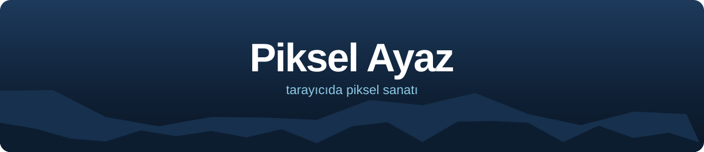
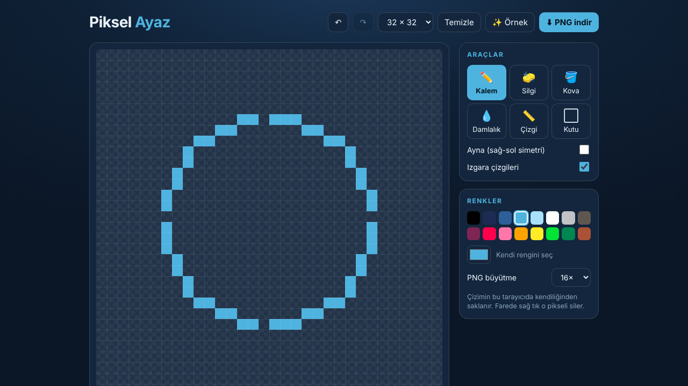

<!-- ENS:TANITIM -->
## 📸 Ekran görüntüsü

<!-- /ENS:TANITIM -->

Tarayıcıda piksel sanatı çiz, PNG olarak indir. Kurulum yok, hesap yok.

**[→ Çizmeye başla](https://enskygr234.github.io/piksel-ayaz/)** — ilk kez açınca **✨ Örnek**'e bas, bir kardan adam belirsin.

## Araçlar

| Araç | Kısayol | Ne yapar |
|---|---|---|
| ✏️ Kalem | B | Piksel boyar; hızlı çizsen de boşluk kalmaz |
| 🧽 Silgi | E | Pikseli siler (farede sağ tık da siler) |
| 🪣 Kova | G | Aynı renkteki alanı doldurur |
| 💧 Damlalık | I | Tuvaldeki rengi seçer |
| 📏 Çizgi | L | Düz çizgi (önizlemeli) |
| ⬜ Kutu | R | Dikdörtgen çerçeve |
| Ayna | M | Sağ-sol simetrik çizer |

- **Geri al / yinele:** Ctrl + Z, Ctrl + Y (150 adım).
- **Tuval:** 16, 24, 32 ya da 48 piksel.
- **Renkler:** 16 renklik palet ve istediğin rengi seçebileceğin renk seçici.
- **İndirme:** PNG saydam arka planlıdır; 8×, 16× ya da 32× büyütülür.
- **Kayıt:** Çizimin tarayıcında kendiliğinden saklanır.

## Lisans

[MIT](LICENSE) © Winterdeveloper

<!-- ENS:ALT -->
---

**❄️ ENS Developer'ın diğer projeleri**

🌐 Web: [Wintercle](https://github.com/Enskygr234/wintercle) · [Buz Şifre](https://github.com/Enskygr234/buz-sifre) · [Kar Tanesi](https://github.com/Enskygr234/kar-tanesi) · [Nardugan](https://github.com/Enskygr234/nardugan) · [kar.js](https://github.com/Enskygr234/kar-js)

[🌐 Bütün projeler](https://enskygr234.github.io/ensdewloper.github.io/) · [👤 GitHub profilim](https://github.com/Enskygr234)

Kış gelir, kod yazılır.

<!-- /ENS:ALT -->
